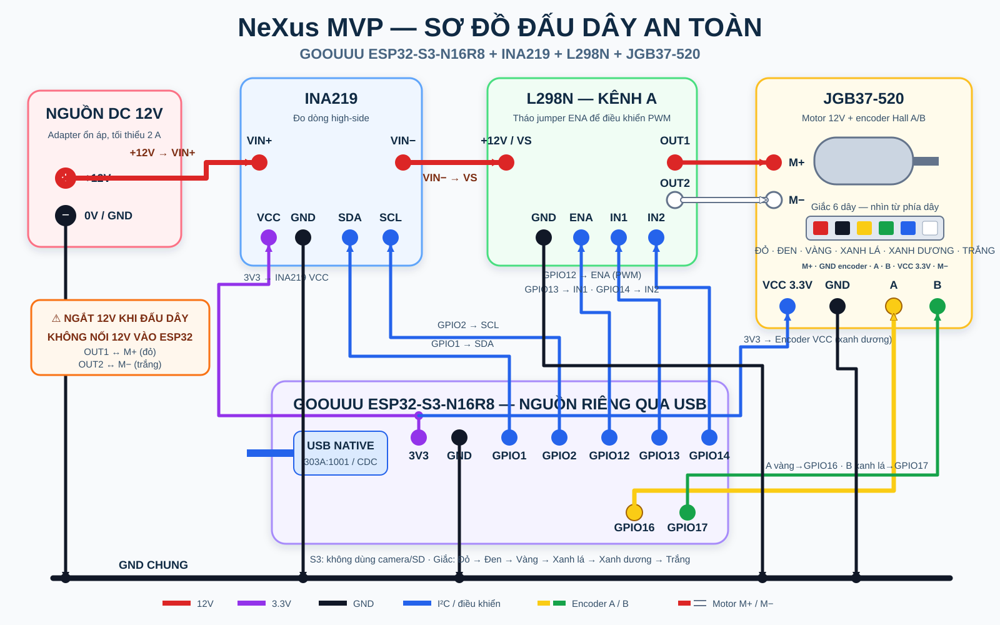

# nexus-firmware

The default firmware matches the current three-wheel robot: one ESP32-S3
DevKitC-compatible N16R8 44-pin board, DFRobot Gravity INA219 SEN0291, two L298N modules, three
JGB37-520 Hall-encoder motors and the 9-pin PS2 wireless receiver. It starts with every motor
off, requires valid INA219 power plus valid PS2 packets, automatically arms only after centred
joystick packets, and emits the telemetry v1 envelope plus three-wheel fields.

## Active three-wheel pin map

| Function | GPIO / terminal |
| --- | --- |
| INA219 SEN0291 | SDA GPIO1, SCL GPIO2, address `0x40`; VCC 3V3; IN+ from relay NO; IN− to MOTOR+ |
| Motor 1 / L298N #1 A | ENA 12, IN1 13, IN2 14, encoder A/B 16/17 |
| Motor 2 / L298N #1 B | ENB 15, IN3 18, IN4 21, encoder A/B 4/5 |
| Motor 3 / L298N #2 A | ENA 6, IN1 7, IN2 8, encoder A/B 9/10 |
| PS2 receiver | DATA 38, CMD 39, ATTN 40, CLK 41, VCC 3V3, common GND |

`ACK`, `NC` and `VIBR` on the PS2 receiver remain disconnected for the MVP. DATA needs a 10 kΩ
pull-up to 3V3. Never feed a 5 V receiver output directly into an ESP32 GPIO. Press SELECT to
latch emergency stop; START clears it only when power is safe and the sticks are centred. Normal
startup automatically enables manual control after centred packets. A missing PS2 packet for
350 ms stops all three motors.

The movement mixer assumes three omni wheels mounted 120° apart. With ordinary non-omni wheels,
the same triangular layout will scrub and the vector mixer is not mechanically valid. The
`1320` encoder-count value is a starting value for a common 11-PPR encoder and 30:1 gearbox; it
must be calibrated against one measured output-shaft revolution.

The authoritative profile is
[`nexus-profile-esp32-s3-devkitc-ina219-dual-l298n-3wheel-ps2-v2.json`](../nexus-hardware/profiles/nexus-profile-esp32-s3-devkitc-ina219-dual-l298n-3wheel-ps2-v2.json),
and the seven-page matching diagram is
[`nexus-wiring-schematic-v9.html`](../docs/wiring-schematic-v9/nexus-wiring-schematic-v9.html).

Power the ESP32 through its USB-C UART/COM connector with one regulated 5 V source: either the buck output while the car is
standalone or the PC while uploading/logging. Do not use both simultaneously. The 44-pin
expansion base is a GPIO breakout in this design; its DC jack remains unused and must never
receive the 3S LiPo/12 V rail.

## Legacy one-motor firmware

The older PlatformIO environments remain available for U05/N03/N05 evidence and command tests.
They compile `src/main.cpp`; the default three-wheel environment compiles
`src/main_three_wheel_ps2.cpp`.

## Legacy one-motor MVP state

Available now:

- calibrated INA226 voltage/current reads
- L298N channel A enable and direction output
- local `NEXUS_MAX_PWM_PERCENT` clamp
- one JSON telemetry sample per second
- INA226 manufacturer/die-ID verification plus explicit readiness and I²C failure logs
- per-sample SDA/SCL idle-level, address ACK, INA226 identity and shunt/current consistency checks
- Hall encoder A/B edge monitoring whenever the driver is commanded to run
- invalid sensor values are withheld instead of emitting non-standard `nan` JSON
- field names shared with backend and frontend contract v1
- correlated serial commands with ACK/result/error and before/after snapshots
- duplicate-request replay protection and strict argument/timeout validation

The device always starts with the driver disabled. Normal firmware accepts safe reads,
`reset_driver`, and stopped-state INA226 recalibration, but rejects motor writes. The separate
supervised command-test build enables bounded motor writes for N03 acceptance.

## Hardware required

- GOOUUU Tech ESP32-S3-N16R8 (16 MB flash, 8 MB PSRAM)
- INA226 voltage/current sensor module with an `R100` (0.1 Ω) shunt
- L298N dual H-bridge motor driver module
- JGB37-520 12 V brushed DC gearmotor with Hall A/B encoder
- regulated 12 V motor supply sized for the motor
- USB data cable
- jumper wires and a physical way to disconnect motor power quickly

Do not power the motor from the ESP32 3.3 V or 5 V pin. Connect all grounds correctly and check the exact terminal labels and jumper positions on your L298N module before applying motor power.

## Signal wiring used by the code

| From | To | Purpose |
| --- | --- | --- |
| ESP32-S3 GPIO1 | INA226 SDA | I²C data |
| ESP32-S3 GPIO2 | INA226 SCL | I²C clock |
| INA226 VBUS | INA226 VIN− | Required bus-voltage reference; bridge the module's VBUS jumper or wire it to the load side |
| ESP32-S3 GPIO12 | L298N ENA | Channel A PWM speed control; remove the ENA jumper for GPIO PWM |
| ESP32-S3 GPIO13 | L298N IN1 | Direction input; HIGH while running in the current firmware |
| ESP32-S3 GPIO11 (row S) | L298N #1 IN2 | Motor 1 direction input; GPIO14 is not used because the expansion board does not expose its S row |
| L298N OUT1 | Motor M+, red wire | Motor channel A output |
| L298N OUT2 | Motor M−, white wire | Motor channel A output |
| ESP32-S3 GPIO16 | Motor encoder C1/A, green wire | Reserved for encoder pulse input |
| ESP32-S3 GPIO17 | Motor encoder C2/B, yellow wire | Reserved for encoder pulse input |
| ESP32-S3 3V3 | Encoder VCC, blue wire | 3.3 V encoder supply |
| ESP32-S3 GND | INA226 GND, L298N GND and encoder GND, black wire | Common signal reference |

For high-side current measurement, place INA226 in the positive motor-supply path according to the module manufacturer's markings: adapter `+12V → VIN+`, then `VIN− → L298N +12V`. INA226 measures bus voltage through its separate `VBUS` input, so `VBUS` must be connected to `VIN−` for load-side voltage. Some modules provide a solder jumper; others expose a separate VBUS pad. Do not guess `VIN+` and `VIN-` orientation.

The MVP calibration is deliberately fixed to the confirmed `R100` shunt: `0.1 Ω`, current LSB `0.1 mA`, calibration register `512`. A measured `2.6 mV` shunt drop therefore represents approximately `26 mA`. If the physical resistor marking changes, update both constants in `firmware/src/main.cpp` and revalidate with a multimeter before running the motor.

### Wiring diagram



The diagram includes the JGB37-520 A/B encoder wiring on GPIO16 and GPIO17. The firmware counts
edges on both channels to detect a missing or noisy signal during commanded motion. It does not
yet convert those edges to a calibrated shaft RPM, so `motor_rpm` remains `null`. At PWM 0 the
encoder is intentionally reported as not testable rather than falsely healthy.

For L298N channel A, ENA receives PWM while IN1/IN2 choose direction. The current MVP firmware implements only IN1 HIGH and IN2 LOW. Stop the motor before changing direction. Do not connect the L298N module's 5 V output to the ESP32 3V3 rail; the ESP32 and encoder use the ESP32's USB/3V3 supply shown in the diagram.

This pin map assumes the GOOUUU camera, microSD slot, and display expansion are not used in the MVP. GPIO12, GPIO13, GPIO16, and GPIO17 overlap camera-interface signals on the camera-capable board. Do not attach a camera while using this wiring. GPIO0, GPIO3, GPIO19, GPIO20, GPIO26–GPIO37, GPIO45, and GPIO46 are intentionally avoided because of boot, USB, flash, or PSRAM restrictions.

The authoritative machine-readable BOM, topology, electrical constraints and firmware mapping
are in [`nexus-hardware/profiles/nexus-profile-goouuu-esp32-s3-ina226-l298n-jgb37-v1.json`](../nexus-hardware/profiles/nexus-profile-goouuu-esp32-s3-ina226-l298n-jgb37-v1.json).
The older contract fixture remains an API example rather than the build source of truth.

## Install PlatformIO

On Windows, double-click `nexus-upload-firmware.cmd` to upload through the board's USB-to-UART
COM connector. Then close every Serial Monitor and double-click `nexus-start-app.cmd`; the
backend owns the COM port, saves `logs/hardware-live-*.ndjson`, and streams the same firmware
log to the Hardware Graph UI. Use `nexus-run-firmware.cmd` only while the app is stopped.

Python 3.11 is recommended.

```bash
python -m pip install platformio
pio --version
```

Alternatively, use the PlatformIO extension in VS Code, but the CLI commands below are the reproducible path used by the team.

## Detect the ESP32 port

Connect the board with a USB data cable, then run:

```bash
pio device list
```

Use the board connector that creates a COM port (usually labelled `UART` or connected to the
USB-to-UART bridge). The second connector is native USB/OTG and uses the optional
`nexus-esp32-s3-devkitc-3wheel-ps2-native-usb` environment. Typical port names are:

- Windows: `COM4`
- Linux: `/dev/ttyUSB0` or `/dev/ttyACM0`
- macOS: `/dev/cu.usbserial-*`

Use the actual port printed on your machine.

## Build firmware

Run from the repository root:

```bash
pio run --project-dir firmware
```

The default PlatformIO environment is `nexus-esp32-s3-devkitc-3wheel-ps2`. It uses PlatformIO's
standard `esp32-s3-devkitc-1` board baseline, which is compatible with the pictured 44-pin
DevKitC layout and does not depend on optional PSRAM. This is sufficient for the NeXus MVP even
when the fitted module has more flash/PSRAM.

## Upload and monitor on Windows

For the USB-to-UART connector, stop any open monitor with `Ctrl+C`, then upload to the detected
COM port (the click launcher and PlatformIO normally auto-detect it):

```powershell
pio run --project-dir firmware --environment nexus-esp32-s3-devkitc-3wheel-ps2 --target upload --upload-port COM8
pio device monitor --port COM8 --baud 115200
```

Press `Ctrl+C` to leave the serial monitor.

The one-click `nexus-monitor-firmware.cmd` and `nexus-run-firmware.cmd` launchers add PlatformIO's `log2file` filter automatically. Each standalone session is stored as `logs/device-monitor-YYMMDD-HHMMSS.log` relative to the repository root. Keep the monitor open for the full baseline interval, then press `Ctrl+C` so the file is flushed and closed cleanly.

## Upload and monitor on macOS or Linux

Replace `/dev/ttyUSB0` with your detected port:

```bash
pio run --project-dir firmware --target upload --upload-port /dev/ttyUSB0
pio device monitor --port /dev/ttyUSB0 --baud 115200
```

On Linux, serial access may require adding your account to the `dialout` group and signing in again. Follow your distribution's policy rather than running PlatformIO permanently as root.

## Hardware-as-code build configuration

`platformio.ini` selects one `custom_nexus_hardware_profile`. Before every build, PlatformIO
validates its required build fields and generates
[`include/nexus_hardware_profile.generated.h`](include/nexus_hardware_profile.generated.h).
Do not edit the generated header. Change the versioned JSON profile, run
`nexus-validate-hardware-profile.cmd`, and rebuild.

The current generated values are:

| Flag | Default | Meaning |
| --- | --- | --- |
| runtime `device_id` | `nexus-{board_id}-{12-hex-chip-id}` | Stable identity derived from the ESP32 eFuse MAC at boot |
| `NEXUS_HARDWARE_MODEL_ID` | `nexus-s3-devkitc-ina219-dual-l298n-3wheel-ps2-v2` | Frozen DevKitC/INA219/dual-L298N hardware identity |
| `NEXUS_MAX_PWM_PERCENT` | `80` | Absolute firmware PWM ceiling |
| `NEXUS_MAX_CURRENT_MA` | `3500` | Total three-motor current limit below the physical 4 A fuse |
| `NEXUS_MIN_BUS_VOLTAGE_MV` | `9500` | Minimum measured motor bus for motion |
| `NEXUS_MAX_BUS_VOLTAGE_MV` | `13000` | Maximum verified MVP motor bus for motion |

All build values come from the JSON profile; the device ID is derived from the physical chip. Do not
raise the PWM ceiling until the physical hardware baseline and temperature checks are complete.
Never store Wi-Fi or broker credentials in the profile or `platformio.ini`.

## Telemetry output

At 115200 baud, the device emits one compact JSON object per line:

```json
{
  "schema_version": "1.0.0",
  "device_id": "nexus-esp32-s3-devkitc-1-44pin-30eda027da00",
  "hardware_model_id": "nexus-s3-devkitc-ina219-dual-l298n-3wheel-ps2-v2",
  "sample_id": "nexus-esp32-s3-devkitc-1-44pin-30eda027da00-42",
  "recorded_at": null,
  "sequence": 42,
  "measurements": {
    "bus_voltage_v": 11.96,
    "current_ma": 840.0,
    "power_mw": 10046.4,
    "pwm_percent": 0,
    "driver_enabled": false,
    "motor_rpm": null
  },
  "quality": {
    "signal_quality_percent": 100.0,
    "source": "device"
  }
}
```

`recorded_at` remains `null` until a later transport task synchronizes device time. The backend may stamp receipt time but must not rename the field. `motor_rpm` is also `null` until the firmware encoder task reads GPIO16/GPIO17 and converts pulses to RPM.

The firmware also emits readable signal-health lines. A telemetry packet is emitted only after
SDA/SCL are idle-high, address `0x40` acknowledges, the manufacturer/die identity matches, all
register reads succeed, every value is finite, and current agrees with the independent R100
shunt-voltage calculation. A failed check is discarded instead of being presented as a real
measurement. The backend converts these codes into a Vietnamese explanation and repair step in
the UI immediately:

| Firmware code | What it proves | First repair action |
| --- | --- | --- |
| `I2C_SDA_STUCK_LOW` | SDA/GPIO1 is electrically held LOW while the bus should be idle | Power off; inspect SDA and pull-up |
| `I2C_SCL_STUCK_LOW` | SCL/GPIO2 is electrically held LOW while the bus should be idle | Power off; inspect SCL and pull-up |
| `INA219_I2C_NO_ACK` | Lines are idle-high but address `0x40` does not answer | Check SEN0291 3V3, GND, SDA/SCL order and A0/A1 switches |
| `INA219_CONFIGURATION_MISMATCH` | A device answered but its config/calibration did not persist | Confirm SEN0291 and reset the board |
| `HARDWARE_PROFILE` | Firmware declares its compiled BOM fingerprint every 10 seconds | Backend compares it with the locked MVP BOM before trusting the profile |
| `INA219_I2C_FAILURE` | A register transaction failed after detection | Reseat SDA/SCL and shorten/noise-proof the leads |
| `INA219_SIGNAL_INVALID` | Current register disagrees with `shunt_mV / 0.1 Ω` | Check SDA/SCL noise, the CJMCU-226 R100 shunt and calibration |
| `ENCODER_CHANNEL_A_MISSING` | B has edges during motion but A/GPIO16 does not | Check the green C1/A wire |
| `ENCODER_CHANNEL_B_MISSING` | A has edges during motion but B/GPIO17 does not | Check the yellow C2/B wire |
| `ENCODER_SIGNAL_MISSING` | Neither channel has edges while the driver is on | Check encoder 3V3/GND/A/B and whether the motor turns |
| `ENCODER_SIGNAL_INVALID` | Too many impossible simultaneous A/B transitions | Check swapped/loose leads and motor-noise routing |

The firmware retries INA219 every five seconds. `[NEXUS][INFO][ENCODER_SIGNAL_OK]` clears an
encoder fault after a later supervised run produces valid A/B edges.

## Supervised U05 baseline mode

Normal firmware never accepts USB motor commands. The separate PlatformIO environment
`nexus-goouuu-esp32-s3-n16r8-baseline` enables only three local commands for the supervised
U05 fixture test: `NEXUS BASELINE START <PWM>`, `NEXUS BASELINE KEEPALIVE`, and
`NEXUS BASELINE STOP`. PWM is still clamped to 80%, the motor boots off, and missing
keepalive stops the driver within four seconds.

Use the root `nexus-run-hardware-baseline.cmd`; it runs at 30% PWM, saves evidence, then
restores normal firmware automatically. Do not upload the baseline environment for normal
application use. See [`../docs/hardware-baseline-u05.md`](../docs/hardware-baseline-u05.md).

## N03 device command mode

The USB serial command protocol is documented and machine-checked under
[`protocol/v1`](protocol/v1/README.md). It supports `read_voltage`, `read_current`,
`read_gpio`, `enable_driver`, `set_pwm`, `run_motor_test`, `reset_driver`, and
`recalibrate_sensor`. The host copies canonical `tool_call_id` into device `request_id`, so
the frozen Tool Call v1 contract does not change.

Normal firmware returns `COMMAND_WRITES_DISABLED` for `enable_driver`, `set_pwm`, and
`run_motor_test`. For a supervised physical acceptance session on Windows, stop the app and
all serial monitors, then double-click `nexus-upload-command-firmware.cmd`. Afterwards use:

```powershell
python scripts/nexus_device_command.py read_voltage --port COM8 --request-id n03-read-1
python scripts/nexus_device_command.py read_gpio --port COM8 --pin-id gpio_16 --request-id n03-gpio-1
python scripts/nexus_device_command.py set_pwm --port COM8 --pwm-percent 20 --confirm-write --request-id n03-pwm-1 --verify-duplicate
python scripts/nexus_device_command.py enable_driver --port COM8 --enabled --confirm-write --request-id n03-enable-1
python scripts/nexus_device_command.py reset_driver --port COM8 --request-id n03-stop-1
```

Replace `COM8` with the detected port. Keep the quick 12 V disconnect in reach. The command
client refuses motor writes without `--confirm-write`; firmware independently enforces bus,
current, PWM and duration bounds. See
[`../docs/n03-command-adapter.md`](../docs/n03-command-adapter.md) for the acceptance matrix.

## N05 fault-test mode

`nexus-goouuu-esp32-s3-n16r8-fault-test` extends the supervised command build with four
explicit test-only profiles: PWM forced to zero, PWM frequency reduced to 100 Hz, INA226
reading offset by +200 mA, and a marker for the operator-controlled OUT2/M− disconnect.
It never changes the default-safe build. Double-click `nexus-run-n05-fault-acceptance.cmd`
to run every profile 5/5, restore normal settings and save local evidence. Read
[`../docs/n05-fault-injection.md`](../docs/n05-fault-injection.md) before touching OUT2.

## Firmware contract files

- Field-name constants: [`include/nexus_contract_v1.h`](include/nexus_contract_v1.h)
- Canonical telemetry schema: [`../nexus-contracts/v1/schemas/telemetry.schema.json`](../nexus-contracts/v1/schemas/telemetry.schema.json)
- Valid telemetry fixture: [`../nexus-contracts/v1/fixtures/telemetry.example.json`](../nexus-contracts/v1/fixtures/telemetry.example.json)
- Device command/response schemas: [`protocol/v1`](protocol/v1/README.md)

After changing a telemetry field, run `python scripts/validate_contracts.py` from the repository root. A frozen schema change also requires a migration note.

## Safety before every hardware run

1. Keep motor power off while changing wires.
2. Confirm common ground, INA226 polarity, and the `R100` marking.
3. Confirm L298N supply polarity, ENA jumper state, and that the motor supply is within the motor and driver ratings.
4. Keep the motor mechanically clear and secured.
5. Keep a quick motor-power disconnect within reach.
6. Start with the driver disabled and low PWM.
7. Stop immediately if the driver, wiring, or motor overheats or smells abnormal.

The 30-minute baseline, temperature result, supply rating, and photos belong to backlog item U05/N01 and are not claimed complete by this README.

## Common problems

- No port appears: replace charge-only USB cables; for native USB, look for VID:PID `303A:1001`; for the USB-TTL connector, install the CH343 driver and reconnect.
- `Failed to connect ... No serial data received`: do not add `--upload-port COM8` when using the connector printed `ESP32`; the project uploads over built-in USB-JTAG. If USB-JTAG reports a Windows driver error, move the cable to the connector printed `CH343`, temporarily set `upload_protocol = esptool`, detect its new COM port, and upload to that port after entering bootloader mode if needed.
- Port is busy: close every serial monitor and IDE serial window before upload.
- INA226 is not detected: check SDA/SCL, common ground, 3.3 V module power, and I²C address `0x40`.
- SDA/SCL looks connected but values are suspicious: use the latest firmware and wait for
  `INA226_READY`; it checks chip identity and R100 current consistency before emitting telemetry.
- Encoder fault appears: do not test continuity with motor power on. Power off, reseat the named
  A/B/VCC/GND wire, then use a short supervised motor test to verify recovery.
- `INA226_ID_MISMATCH`: confirm the IC is really INA226 rather than INA219/INA260 and reset the board.
- `HARDWARE_PROFILE`: must report the same `profile_id`, `hardware_model_id`, sensor and driver
  declared by the selected JSON profile. A different value means the board was flashed with a
  binary generated from another hardware build.
- Current is correct but bus voltage stays at 0 V: connect the INA226 `VBUS` input to `VIN−`; measuring 12 V at the screw terminal alone does not prove that the IC's VBUS pin is connected.
- Readings are negative: verify INA226 current direction and `VIN+`/`VIN-` orientation.
- Current is exactly eight times too high: the board still has INA219-calibrated firmware; upload this repository's INA226 build.
- Motor never starts: confirm external motor power, ENA jumper/PWM wiring, IN1/IN2, common ground, and the local safety clamp.
- Device resets when the motor starts: isolate motor power noise, inspect supply capacity and wiring, and do not bypass safety limits.
